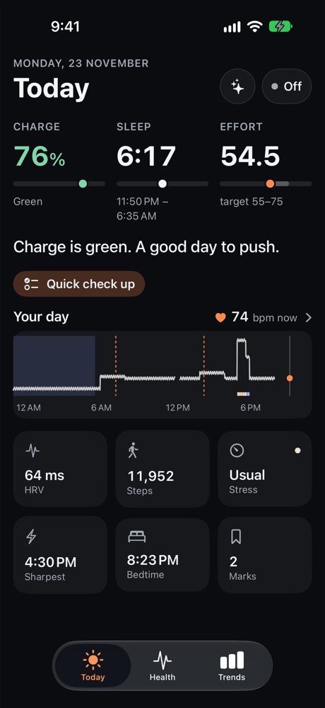
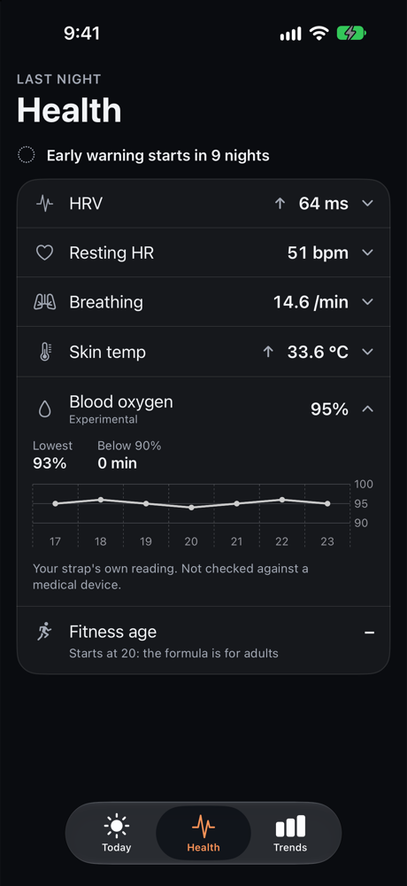
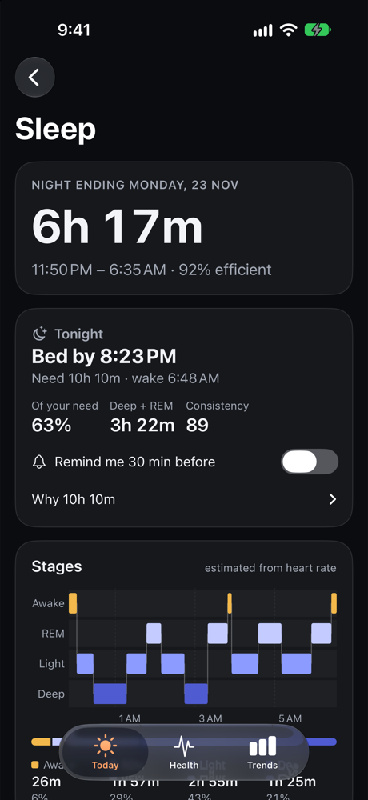
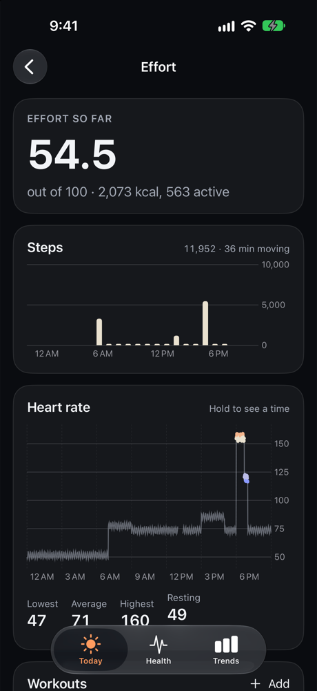

# Tether

An iPhone and Mac app for the WHOOP 5.0 strap that keeps everything on your own phone. It pairs with the strap over Bluetooth, reads what the strap records, and works out recovery, effort, sleep and stress itself, with no account, no subscription and no server.

> Tether is an independent project. It is not affiliated with, endorsed by or connected to WHOOP, Inc. "WHOOP" is used only to name the hardware Tether talks to. Tether is not a medical device, and every number it shows is an estimate.

|  |  |  |  |
|:--:|:--:|:--:|:--:|
| Today | Health | Sleep | Effort |

Screenshots use the app's built-in sample day, not a real person's data.

## Install

You need a Mac with Xcode 26, an iPhone on iOS 26 or later, and an Apple ID. A free Apple ID works, but apps signed with one stop opening after 7 days until you install again.

```sh
brew install xcodegen
git clone https://github.com/shorielol/tether.git
cd tether
Tools/setup.sh com.yourname ABCDE12345     # your own bundle prefix and Apple team ID
Tools/install-on-iphone.sh                 # with the iPhone plugged in and unlocked
```

`setup.sh` swaps the app's identifiers for yours, so it signs under your account. Your team ID is in Xcode under Settings, Accounts. If the app won't open after installing, trust your Apple ID on the phone in Settings, General, VPN & Device Management.

Then open Tether, pick your strap and accept the pairing prompt. If the strap is still bonded to another phone or Mac, forget it there first.

## What it does

- Syncs the strap's stored history (heart rate, beat-to-beat intervals, skin temperature, motion, steps and strap taps) when you open the app and about every 30 minutes while the phone is near the strap. Live heart rate comes over the same link.
- **Charge**, 0 to 100%: last night's HRV, resting heart rate, sleep, breathing rate and skin temperature against your own normal, which it learns over your first nights.
- **Effort**, 0 to 100: time spent in your heart-rate zones through the day, with a target band set by that morning's Charge.
- **Sleep**: when you fell asleep and woke, stages estimated from heart rate and movement, how much you need tonight and when to be in bed.
- **Stress**: each waking hour's heart rate and HRV compared with the calmest part of your own day. Hours you spent moving are left out.
- Every score opens to the arithmetic behind it, with your own numbers, and Charge has a what-if sheet.
- **Health**: HRV, resting heart rate, breathing and skin temperature against your normal, a warning when several drift together, and blood oxygen from the strap's own nightly reading (marked experimental).
- A silent alarm set on the strap, with an optional window that wakes you early if you're surfacing from deep sleep.
- Double-tap the strap to mark a moment, then name it. After a few marks with the same name, Tether shows what it usually does to your heart rate.
- Workouts found from heart rate and motion, an energy forecast for the day, a morning check-up of things like late coffee, and trends over 7, 30 and 90 days.
- Ask questions about your numbers. Answers come from Apple's on-device model where Apple Intelligence is on, and from written explanations where it isn't.
- Widgets: a Now widget that shows Charge in the morning, your plan during the day and bedtime in the evening, plus a Charge ring for the lock screen.
- A Mac app that reads the day files the iPhone writes to an iCloud Drive folder you choose.

## Your data

Everything is stored in a SQLite database on the phone. Tether sends nothing to any server, including the coach. The only copy that leaves the phone is the iCloud Drive folder, if you pick one for the Mac app, and that folder belongs to your account.

Tether sends the strap only these commands: the hello that starts a session, history requests and acknowledgements, setting its clock, and setting or cancelling its alarm. If a strap refuses history, Tether says so and stops. It does not try to get around WHOOP's membership checks.

## Limits

- Tested on one WHOOP 5.0 on firmware 50.41.1.0. The WHOOP 4.0 and MG haven't been tried. Other projects report that firmware 50.43.x withholds data; Tether hasn't been tested on it, and updating through WHOOP's own app may change what the strap sends.
- Not yet confirmed on a real strap: the silent alarm and its wake window, and stress alerts.
- Blood oxygen is the strap's own number and hasn't been checked against a medical device. It never feeds Charge or the health warning.
- Fitness age only shows for people aged 20 to 80, because the formula behind it is for adults.
- With a free Apple ID the app expires every 7 days. `Tools/auto-reinstall.sh` can reinstall it from your Mac over Wi-Fi; `Tools/com.shorielol.tether.reinstall.plist` is a LaunchAgent template that runs it every 6 hours.

## How it's built

- `App/iOS`, `App/macOS`, `App/Widgets`: the SwiftUI apps and the widget extension. `project.yml` generates the Xcode project with XcodeGen.
- `Packages/TetherCore`: the collector, scoring, and every feature's logic, with Swift Testing tests (`swift test`).
- `Packages/TetherSnapshot`, `Packages/TetherFiles`: what the widgets read, and the day files the Mac reads.
- `Packages/WhoopProtocol`, `WhoopStore`, `StrandAnalytics`: the Bluetooth protocol, storage and analytics, vendored from NOOP. Changes Tether made to them are marked `// tether:`.

## Credits and licence

Tether builds on [NOOP](https://github.com/ryanbr/noop), an offline WHOOP companion, and on the reverse-engineering work NOOP credits in `ThirdParty/NOOP-ATTRIBUTION.md`. NOOP's licence, notices and disclaimer are kept in `ThirdParty/`.

Tether is released under the [PolyForm Noncommercial License 1.0.0](LICENSE): you can use, change and share it for free, but not commercially. NOOP's code uses the same licence.
